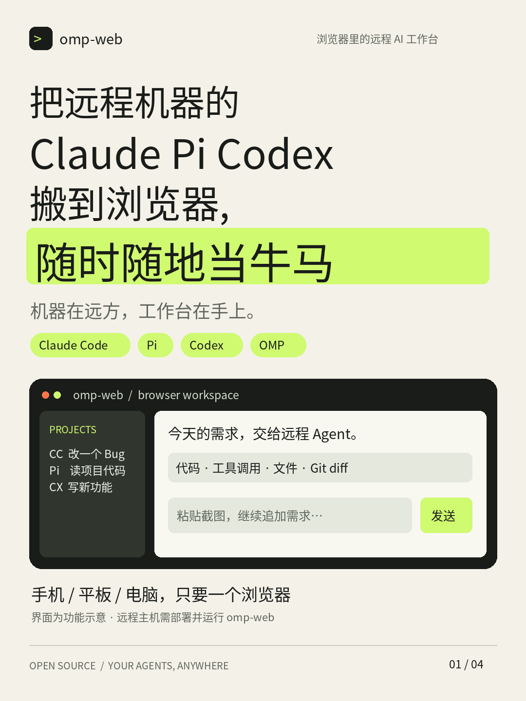
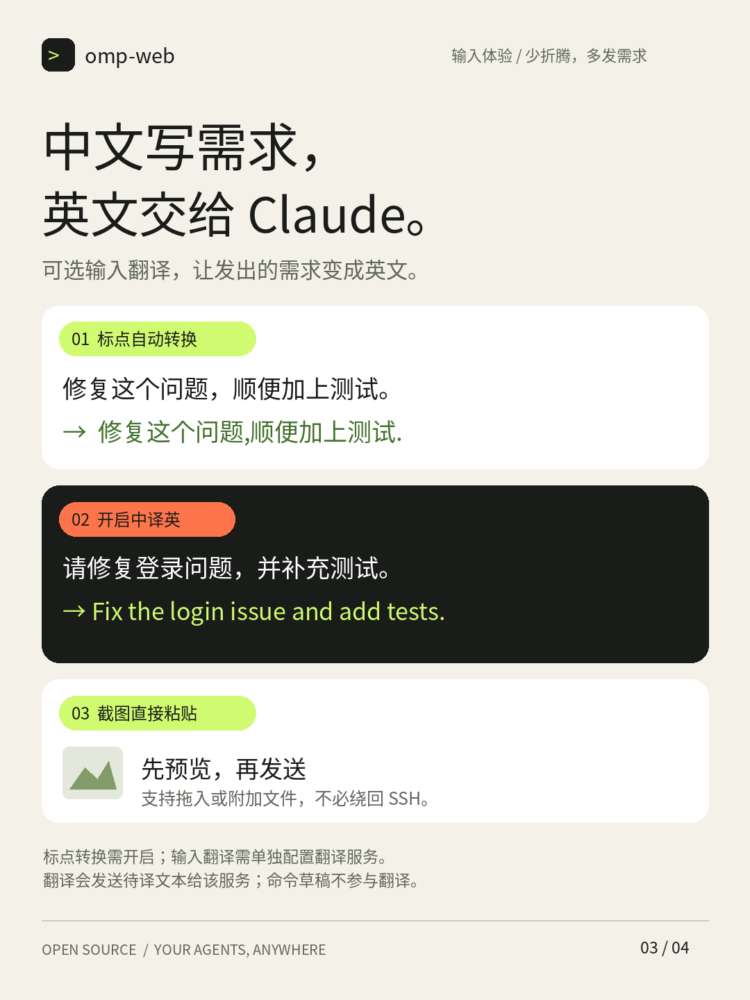

# omp-web · Coding agents, terminal, and project files in one browser

[English](./README.md) · [简体中文](./README.zh-CN.md) · [Website](https://leafiy.github.io/omp-web/)

| Browser workspace | Remote architecture |
| --- | --- |
| [](./public/promo/xiaohongshu/01-cover.png) | [](./public/promo/xiaohongshu/02-architecture.png) |
| **Input helpers** | **Everyday development** |
| [](./public/promo/xiaohongshu/03-input.png) | [](./public/promo/xiaohongshu/04-workflow.png) |

On my PC, omp-web has replaced the standalone terminal window. **Set up the host once. There's nothing to configure in the browser: open the URL, sign in, and pick a project.** OMP, Pi, Claude Code, and Codex keep using their own accounts and models on the host.


## Core features

### 1. Files: drop, edit, preview

- **Drag and drop:** Drop a file onto a folder to upload it there, or into the composer to attach it to a request. Paste screenshots straight from the clipboard.
- **Quick edits:** Fix a typo without another prompt or a remote IDE session. Edit Markdown, plain text, HTML/CSS, JS/TS, Python, shell, SQL, JSON, YAML, and more in the file panel.
- **Preview and review:** View rendered Markdown, HTML, images, PDFs, and DOCX files, or play audio and video. Open a Git diff to see what changed; select source lines to reference them in a question.
- **File manager:** Create, copy, move, rename, delete, and download. Open or download a generated report right from the agent's reply.

<details>
<summary>Editable file extensions (UTF-8, up to 256 KiB per file)</summary>

- Documents: `.md`, `.markdown`, `.mdx`, `.txt`
- Frontend: `.htm`, `.html`, `.css`, `.scss`, `.js`, `.jsx`, `.mjs`, `.cjs`, `.ts`, `.tsx`
- Scripts and queries: `.py`, `.sh`, `.sql`
- Data and configuration: `.json`, `.jsonl`, `.csv`, `.xml`, `.yaml`, `.yml`, `.toml`, `.ini`, `.conf`

</details>

### 2. Agents and terminal: let it edit, run your own checks

- **Four engines:** Pick a model for the project, browse skills, and type `/` for commands. Start a task in its own Git worktree.
- **Guide a run:** Use Steer to change direction or queue the next request with Follow-up. Take a queued message back to edit it.
- **Less input cleanup:** Long pastes fold out of the way and drafts stay with their chat. Convert fullwidth punctuation automatically, or enable Chinese–English translation for prompts and replies.
- **Independent terminal:** Open shell tabs for tests, logs, or the full native TUI. Reconnect after a refresh. Terminal output isn't sent to the agent automatically.
- **Approvals and undo:** Approve plans, check MCP status, answer permission requests, fork a conversation, or rewind a change. Availability varies by engine.

<details>
<summary>Compare the four engines</summary>

| Web action | OMP | Pi | Claude Code | Codex CLI |
| --- | --- | --- | --- | --- |
| Chat, images, stop, resume web sessions, model selection | ✓ | ✓ | ✓ | ✓ |
| Web Follow-up queue / take back to edit | ✓ | ✓ | ✓ | ✓ |
| Steer during a run | ✓ | ✓ | When supported by the native version | — |
| Reasoning level / Effort | Model-dependent | Model-dependent | Native-capability-dependent | — |
| Fork / HTML export and full history | ✓ | ✓ | ✓ | — |
| Go back to an earlier message | In-file branch navigation | — | Rewind conversation and/or code | — |
| Permission modes / always allow | — | — | ✓ | — |
| MCP status panel / elicitation | — | — | ✓ | — |
| Stop one background task | ✓ (subagents) | — | ✓ (plus move to background) | — |
| Session deletion | ✓ | ✓ | ✓ | — |
| Shared todo list | ✓ | ✓ | ✓ | ✓ |

</details>

### 3. Sessions and todos: get back to the work, not just the chat

- **Turn a chat or a message into a todo:** Save the whole discussion or just the reply you want to verify. Click the item to jump back to its source. The list is shared across signed-in devices. Agents can read it too: mention it ("do todo item 2") and the numbered list is attached to your message; a copy is also kept in `~/.config/omp-web/todos.md`.
- **Follow several projects:** Search and pin chats, sync read status, see pending approvals and background tasks, and expand older history one turn at a time.
- **Pick up elsewhere:** Closing the browser doesn't itself stop a run. Open the same URL on a phone or tablet to review results, answer approvals, or check off a todo. Context, subscription limits, and token usage are available in the workspace.

## Install

**Host:** Linux (systemd) or macOS, Node.js 22.19.0 or newer (including Node 26), npm, Git, and at least one installed, signed-in agent. File-manager mutations currently require Linux.

```bash
curl -fsSL https://raw.githubusercontent.com/leafiy/omp-web/main/scripts/install.sh | bash
```

1. The installer starts the background service and prints an initial password for `admin` on first install. Open [127.0.0.1:30141](http://127.0.0.1:30141) on the host and sign in. Existing accounts are kept.
2. Choose a project and an engine, drop in a test fixture or paste a screenshot, and send your request.
3. Inspect the diff, run the tests in the embedded terminal, and add any reply you want to revisit to your todos.

New services listen on all IPv4 interfaces (`0.0.0.0:30141`). To restrict access to the host, install or reconfigure with `--service --host 127.0.0.1`. For remote access use HTTPS or a private network. **Don't expose the terminal over public plain HTTP.** Run `bash ~/code/omp-web/scripts/install.sh update` outside the web app to update; a rebuild interrupts chats and terminals. `bash ~/code/omp-web/scripts/install.sh restart` only restarts the installed service on its current build, without updating.

[Manual install and terminal](./docs/self-hosting.zh-CN.md) · [Deployment and updates](./docs/workspace.zh-CN.md) · [Files and attachments](./docs/file-browser.zh-CN.md) · [Claude controls](./docs/claude-code-advanced.zh-CN.md) · [All docs](./docs/)

Built on [17380936778/omp-web](https://github.com/17380936778/omp-web) and [agegr/pi-web](https://github.com/agegr/pi-web). [Changes from upstream](https://github.com/leafiy/omp-web/compare/f09920e04ed4851ad10d86c6fc92d95c2b3485c1...66636ff) · [MIT license](./LICENSE)
