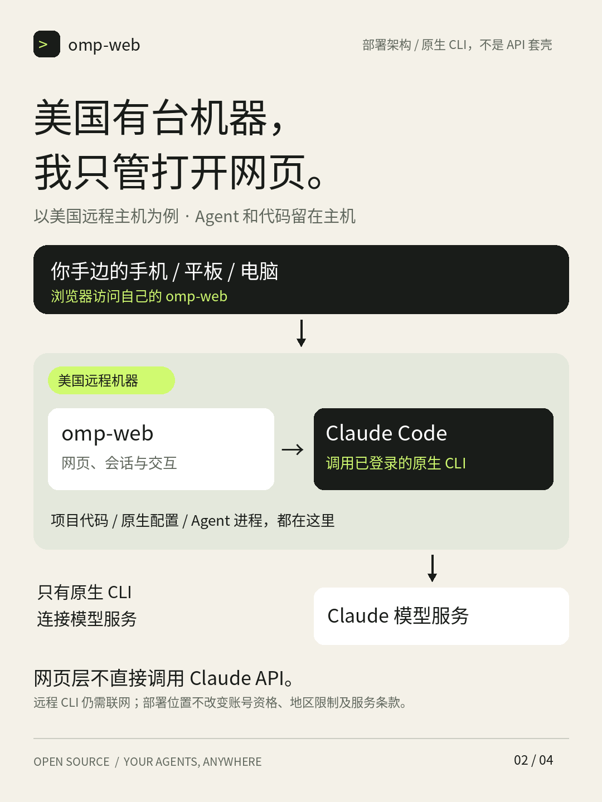
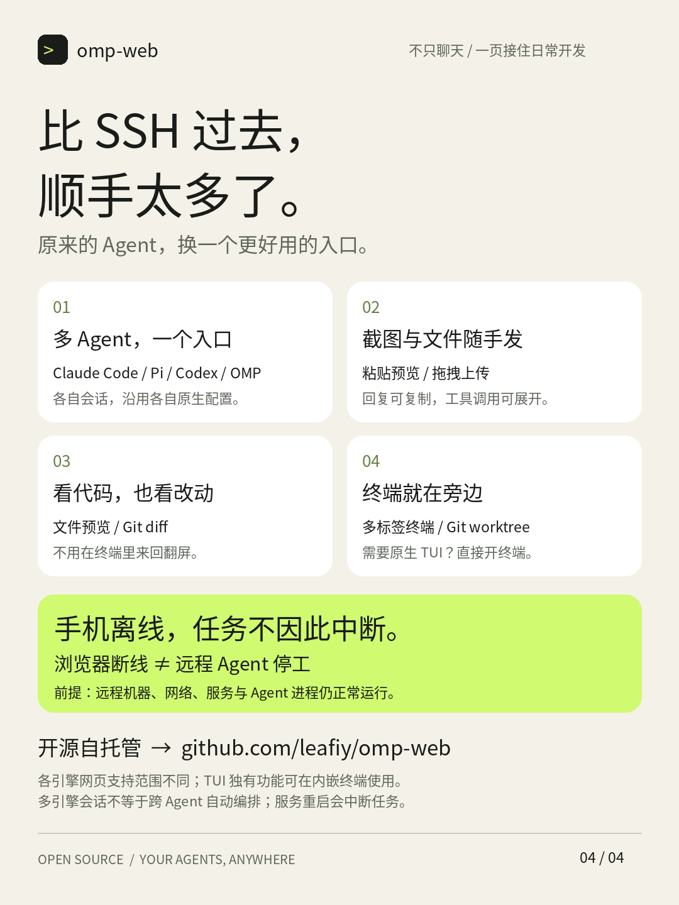

# omp-web · Leafiy's fork

[English](./README.md) · [简体中文](./README.zh-CN.md) · [Website](https://leafiy.github.io/omp-web/)

**Your remote OMP, Pi, Claude Code, and Codex in one browser page, with chat, a terminal, and files side by side.**

This is my personal fork of [17380936778/omp-web](https://github.com/17380936778/omp-web). Upstream already had a solid chat and file-preview interface. My changes add more agents and everyday development tools, and rework session management, input, and the mobile experience.

These are still the agents installed on your machine, using their own logins, models, skills, and project configuration. Your laptop, phone, or tablet only needs a browser.

## Automatic fullwidth-to-halfwidth conversion

**Keep typing with your Chinese IME—no switching modes for punctuation or cleaning it up by hand.** Chinese commas, periods, quotes, and brackets, plus fullwidth letters, digits, and spaces, are converted to their halfwidth/English equivalents before sending:

```text
请检查：“ＡＢＣ１２３”（测试）。
        ↓ Automatically converted before sending
请检查:"ABC123"(测试).
```

On by default, with an off switch remembered in this browser. The same input handling serves all four engines for send, Steer, and Follow-up, **including code and long pastes inside the message**. Conversion happens in the browser, without a model call or translation service.

`!` and `/` command drafts are skipped. Leading fullwidth symbols cannot accidentally turn a message into a command; uploaded files, attachment paths, and existing history are untouched. Characters without a conversion rule stay as typed.


## A four-card introduction

**Bring Claude, Pi, and Codex from your remote machine into the browser.**

Open your existing agents from a phone, tablet, or laptop. These Chinese-language promotional cards illustrate features, not actual UI screenshots. Click an image for the full-size version.

| Browser workspace | Remote architecture |
| --- | --- |
| [](./public/promo/xiaohongshu/01-cover.png) | [](./public/promo/xiaohongshu/02-architecture.png) |
| **Input helpers** | **Everyday development** |
| [](./public/promo/xiaohongshu/03-input.png) | [](./public/promo/xiaohongshu/04-workflow.png) |

## What I changed from upstream

This compares upstream **[`f09920e`](https://github.com/17380936778/omp-web/commit/f09920e04ed4851ad10d86c6fc92d95c2b3485c1)** with this fork at **[`66636ff`](https://github.com/leafiy/omp-web/commit/66636ff)**, not with the original pi-web. The upstream remote still pointed to that commit when checked. [Full source diff](https://github.com/leafiy/omp-web/compare/f09920e04ed4851ad10d86c6fc92d95c2b3485c1...66636ff). Related commits are grouped by feature; repeated fixes are not counted as separate features.

**Credit where it's due:** Chinese localization, Markdown and syntax highlighting, Mermaid and math, file previews, Git diffs, worktrees, forks and branches, image paste, completion sounds, and PWA support already existed upstream. Upstream also included title-generation code and optional Basic Auth. This fork extends, redesigns, or fixes those features; it did not build the whole project from scratch.

### 1. From an OMP interface to a shared home for four agents

| Change | Why it matters |
| --- | --- |
| **Replaced the execution backend:** OMP and Pi now use the installed CLIs over native RPC, rather than the web app's older in-process Pi SDK | The browser and terminal use the same agent installation, reducing version and login mismatches. |
| **Added Claude Code and Codex CLI:** Claude Agent SDK with the local Claude executable; Codex through app-server | No separate web interface for each agent. Missing installations are clearly marked. |
| **Separated each engine's login, configuration, history, and model catalog; pinned existing sessions to their engine** | Accounts and conversations do not get mixed up. Switching engines starts a new chat. |
| **Native models and reasoning controls:** actual catalogs and selections, Claude Effort, and remembered engine/model choices per directory | Less repeated setup, without applying one agent's model choice to another. |
| **Native command menus and argument completion:** added Claude commands and suggestions from native enum hints | Find commands and their arguments after typing `/`; terminal-only actions are not presented as supported web features. |
| **A read-only skills panel scoped to engine and project; disabled the old unscoped auth/model/plugin/skill editors** | See what the selected agent actually exposes. Installation, login, and configuration stay with its CLI, avoiding edits to the wrong store. |

### 2. Claude Code controls that used to need the terminal

| Change | Why it matters |
| --- | --- |
| **Fork and Rewind for Claude Code:** start a new chat from before any message; Rewind restores code from Claude's own checkpoints and/or the conversation, after a dry-run preview of the files that will change | Back out of a wrong turn the way `/rewind` does. Only edits Claude itself made after checkpointing was enabled can be restored; shell commands and outside changes are not undone. |
| **Permission modes — Ask, Accept edits, Plan, Auto — switchable mid-run; leaving Plan mode shows the plan for approval** | The Shift+Tab modes without a terminal. `bypassPermissions` stays terminal-only, and Claude Code decides whether Auto is available to your account and model. |
| **"Always allow" in approval prompts, based on Claude Code's own rule suggestions** | Stop approving the same command again and again. You choose this session only or the settings file Claude names; suggested rule removals are never applied. |
| **MCP status panel** (reconnect, enable/disable for the session) **and MCP elicitation forms/links as web dialogs** | Revive a disconnected server or answer an MCP request without SSH. Server commands, URLs, headers, and env never reach the browser; forms the web can't render are declined. |
| **Native status events:** compaction progress, API retries, hooks, notifications, automatic denials, model fallbacks | A long pause is explained instead of looking like a hang. |
| **Background work controls:** stop one task, or move a running Bash command/subagent to the background | Ctrl+B and per-task stop, without stopping the whole run. |
| **HTML export and full history for Claude Code**, rendered from the web record | Archive or share a Claude chat like an OMP/Pi one. It is a simple, script-free page, not a native Claude export. |
| **The same controls for OMP and Pi wherever their RPC offers them:** stop an OMP subagent, OMP model-fallback and rule notices, Pi summary-retry status | Parity without pretending: neither RPC exposes permission modes, file rewind, or MCP status, so those remain Claude-only. |

### 3. Sessions that are easier to find and follow

| Change | Why it matters |
| --- | --- |
| **Rebuilt the project → session sidebar:** multiple projects, folding, search, expandable lists, and OMP/Pi/CC/CX tags | No constant project-dropdown switching, and no guessing which agent owns a chat. |
| **Moved directory selection into new chats:** recent projects, path browsing, project/folder creation, and worktree selection/creation | Start a chat, then choose where to work. Changing the directory keeps the unsent draft. |
| **Connected native titles:** prefer the agent's title, generate missing titles for new web sessions through that agent, and show new sessions immediately | Chats are easier to identify before the first reply finishes; a long first prompt is no longer used as a substitute title. Fallback naming can make an extra model request. |
| **Added a separate pinned section, stored on the server** | A chat pinned on your laptop is also pinned on your phone, without duplicate rows in project groups. |
| **Synced read/unread state across devices, with project-wide “mark read”** | Reading a result on your phone clears the reminder on your laptop. A late acknowledgement cannot clear a newer result. |
| **Added waiting-for-input badges and sounds, including on collapsed projects** | Find the chat waiting for approval or an answer. Completion sounds also wait for known background work to finish. |
| **Added a shared todo list:** a done/total badge in the top bar opens a card to add, edit, complete, and clear items; one click adds a conversation (from the sidebar) or any message | Keep follow-ups next to the work. An item jumps back to its conversation or exact message, unfolding older history first. Stored on the server (`~/.config/omp-web/todos.json`) and shared by every signed-in device; it is never sent to an agent. |

### 4. More useful input, less lost work

| Change | Why it matters |
| --- | --- |
| **Automatic fullwidth-to-halfwidth conversion, on by default:** Chinese punctuation and fullwidth letters, digits, and spaces are converted before send/Steer/Follow-up | Keep using your Chinese IME without switching modes or fixing symbols by hand. Includes code and long pastes in messages; can be disabled in Settings. |
| **Persistent drafts, scoped to the session or new-chat directory and engine; clear only after confirmed sending** | Refreshing, switching chats, or a failed send is less likely to lose your text. File metadata and long pastes persist; images remain in memory only. |
| **One web Follow-up queue for all four engines, with individual take-back-to-edit** | Write the next request while the agent works. Closing the browser does not pause the server queue, but restarting the service does not preserve it. |
| **Added native Claude Steer, keeping OMP/Pi's own steering behavior** | Supported engines can receive guidance during the current run instead of always waiting for another turn. Codex has no web Steer control yet. |
| **Added “Edit” to sent messages, with confirmation before replacing a draft** | Bring text back, revise, and resend. It does not rewrite history the agent has already consumed. |
| **Ordinary files now have attachment cards:** paste, drop, or select files, including while the agent is running | See names, sizes, previews, and downloads instead of long paths in the composer. Same-name attachments get separate copies, not overwritten project files. Images cannot enter the Follow-up queue. |
| **Completed image previews:** drafts, history, assistant images, and tool images are clickable; Pi's image-coordinate note is hidden | Check screenshots before sending and inspect image results. Viewing an image does not write it into the project. |
| **Long pastes become `[paste #n …]` markers and expandable transcript attachments** | Logs, code, and long requirements no longer fill the composer or conversation. The agent still receives the full text; this does not save tokens. |
| **Added translate-before-send, separately enabled per conversation, for send/Steer/Follow-up** | Write in Chinese and send in English, or vice versa. Failure, cancellation, or editing the draft during translation sends nothing stale. |
| **Added message translations in both directions, alongside the original** | Read replies in your preferred language without changing history. Fenced code stays verbatim; attachment contents are not translated. |

Translation needs a separately configured OpenAI-compatible service, with templates for Index-Translate and Hunyuan-MT. It sends the text to that service and may add latency or cost. Message translation buttons stay hidden without configuration. Translating input does not force the agent's reply language; `!` and `/` command drafts skip translation.

### 5. Less decoration, more readable content

| Change | Why it matters |
| --- | --- |
| **Retuned chat typography:** consistent body text, bubbles, spacing, lists, and controls; fixed CJK emphasis and large ordered-list numbers | Long replies are easier to scan, without stray `**` or crowded text. |
| **Reworked Dark and Starfield:** removed distracting scanlines, clipped corners, and tiny text; fixed dark code/Mermaid detection and made terminal colors follow the theme | Keep the visual identity without sacrificing content or controls. Decorative CSS no longer overrides the chosen syntax colors. |
| **Rebuilt narrow-screen toolbars and composer actions:** compact menus, separate send/stop controls, larger touch targets, keyboard-height and safe-area fixes | Keep typing and stopping within reach when the phone keyboard is open. |
| **Replaced blocking browser confirmations with inline prompts; fixed shortcut conflicts** | Confirmations do not freeze streaming. Closing a menu or typing in the terminal should not accidentally stop chat. |
| **Tool summaries show actual questions/answers and readable structured arguments** | Understand a tool call without opening a long record or seeing `[object Object]`. |
| **Edits and todo lists read like the terminal:** Claude Edit/Write show diffs with real line numbers; Claude's TodoWrite and OMP's todo tool render as checklists | See what changed and what is left without reading raw JSON. Older Claude history falls back to a diff without line numbers. |

### 6. Clearer history, background work, and usage

| Change | Why it matters |
| --- | --- |
| **History now folds and loads by complete user turn, with browser and server caches** | Read recent work first, expand an entire older turn on demand, and avoid downloading everything again. One task is no longer split across message pages. |
| **Separate subagent/background-task status, with related conversations in right-side tabs** | See what is still working after the main reply ends, without mixing child conversations into the main chat. It observes supported native tasks; it is not a new scheduler. |
| **Engine-specific reconnect, completion, and send acknowledgement handling:** state reconciliation, approval replay, stale-response filtering, and message deduplication | Fewer premature “done” states, duplicate messages after refresh, or lost approval prompts. |
| **Native context usage, with the last reported value saved** | No fixed 128K fallback or cumulative billing totals pretending to be current context. Keep the last observation after restart; missing data stays unknown. |
| **Added subscription usage and day/week/month token tables** | See limits, reset times, and consumption. Codex account data is clearly separated from local Claude/OMP/Pi totals, not added into a misleading grand total. |

### 7. Files and a terminal within reach

| Change | Why it matters |
| --- | --- |
| **Added an independent PTY terminal:** tabs, adjustable height, shell/login-shell selection, and reconnect after refresh | Run commands, inspect logs, or open a native TUI without another SSH window. Terminal output is not automatically added to the AI conversation. |
| **Turned the file tree into a file manager:** create, copy, cut, paste, move, rename, delete, download; touch-friendly “More” menus | Do simple file work yourself rather than asking an agent. Operations check allowed paths, conflicts, and changed files. There is no trash/recycle bin. |
| **Uploads target the selected folder, including drag-to-folder, with progress and conflict handling** | Not just the chat root. Navigating during an upload cannot silently change its destination, and replacement does not delete the old file before writing. |
| **Local file links in replies now offer preview and direct download, including `file:`/`sandbox:` links** | Take the generated report straight from the reply instead of hunting for its path. File-access restrictions still apply. |

### 8. Built for regular self-hosted use

| Change | Why it matters |
| --- | --- |
| **Replaced optional Basic Auth with mandatory form login and session cookies; added account changes, logout, and login rate limits** | No browser password popup. Passwords use salted hashes, and changing credentials signs out other browsers. |
| **Added authentication and origin checks to chat/terminal event streams** | Long-lived connections are protected even when they bypass proxy buffering. |
| **CLI versions and individual update controls in Settings** | Update the installed CLI, not the web app's SDK. Update buttons require a verified Linux/root/systemd deployment and recognized installation; success restarts the web service and interrupts work. |
| **Added an installer, Linux systemd/macOS launchd services, and one-step updates; skip unchanged installs/builds using saved state** | Less service setup and redundant work. A dependent service cannot bring the web app back up halfway through a rebuild. |
| **One source/build/runtime directory at `~/code/omp-web`, with location and stop-before-build guards** | Avoid editing one checkout while running another, or starting an incomplete build after failure. |

<details>
<summary>Other compatibility fixes and release work</summary>

- **OMP model compatibility:** corrected provider IDs in cached catalogs, empty endpoints, and API-key overrides shadowing OAuth. Chat subsequently moved to native CLIs; legacy compatibility helpers do not mean the web app manages agent credentials again.
- **Native history protection:** read OMP title slots, model roles, and active branches without rewriting them. Resume, Fork, and export use the owning engine, preserving native IDs and files.
- **Session deletion:** added Claude native transcript/subagent-history and web-display-record deletion, with explicit busy, concurrent-operation, and failure handling. Codex web deletion remains unavailable.
- **Regression coverage and simulated-browser scripts:** RPC, queues, attachments, file operations, auth, mobile layouts, and more. Code checks are manually triggered and separate from production deployment; this is not a claim that the full suite passes.
- **Release materials:** rewritten English/Chinese documentation, feature notes, a bilingual showcase site, screenshots, and promotional cards. Upstream history and MIT notices are retained. This fork installs from GitHub source, not a new public npm release under the same name.

</details>

## Support at a glance

| Web action | OMP | Pi | Claude Code | Codex CLI |
| --- | --- | --- | --- | --- |
| Chat, images, stop, resume web sessions, model selection | ✓ | ✓ | ✓ | ✓ |
| Web Follow-up queue / take back to edit | ✓ | ✓ | ✓ | ✓ |
| Steer during a run | ✓ | ✓ | When supported by the native version | — |
| Reasoning level / Effort | Model-dependent | Model-dependent | Native-capability-dependent | — |
| Fork / HTML export and full history | ✓ | ✓ | ✓ | — |
| Go back to an earlier message | In-file branch navigation | — | Rewind conversation and/or code | — |
| Permission modes / always allow | — | — | ✓ | — |
| MCP status panel / elicitation | — | — | ✓ | — |
| Stop one background task | ✓ (subagents) | — | ✓ (plus move to background) | — |
| Session deletion | ✓ | ✓ | ✓ | — |
| Shared todo list | ✓ | ✓ | ✓ | ✓ |

Claude/Codex currently focus on web-created sessions, not importing all terminal history or taking over running terminal sessions. Task visibility depends on native interfaces or Pi extensions reporting it. Use the embedded terminal for the full TUI.

## Install

**Host requirements:** Linux or macOS, Node.js 22.19.0+, npm, Git, and at least one installed, logged-in CLI: `omp`, `pi`, `claude`, or `codex`. Install as the OS user who normally runs those agents. The file manager's mutation backend is currently Linux-only; macOS installer support does not imply all file operations are available there.

```bash
curl -fsSL https://raw.githubusercontent.com/leafiy/omp-web/main/scripts/install.sh | bash

# Also install a background service: Linux at boot, macOS at user login
curl -fsSL https://raw.githubusercontent.com/leafiy/omp-web/main/scripts/install.sh | bash -s -- --service --host 127.0.0.1 --port 30141
```

The installer checks runtimes but does not install Node or agents. It installs and builds in `~/code/omp-web` and asks you to choose a web username and password. For unattended installation, set `OMP_WEB_USERNAME` and `OMP_WEB_PASSWORD`.

Update:

```bash
bash ~/code/omp-web/scripts/install.sh update
```

It pulls the current branch, installs dependencies and builds when needed, and preserves login, address, and port. Uncommitted changes cause it to refuse; an unchanged build does not require stopping the service. **A rebuild stops the service and interrupts chats and terminals, so run updates outside omp-web.** Use `--force-build` to rebuild, or `--force-install` to reinstall dependencies and rebuild.

Without a background service:

```bash
cd ~/code/omp-web
node bin/omp-web.js --hostname 127.0.0.1 --port 30141
```

Open [http://127.0.0.1:30141](http://127.0.0.1:30141). Reset the web login with `npm run passwd`.

<details>
<summary>Manual installation</summary>

```bash
mkdir -p ~/code
git clone https://github.com/leafiy/omp-web.git ~/code/omp-web
cd ~/code/omp-web
npm ci --include=dev
npm run build
npm run passwd
npm start
```

For existing deployments, stop the service before building. Keep one active source/build directory; see the [single-workspace procedure](./docs/workspace.zh-CN.md). An npm package named `omp-web` may be a different upstream release.

</details>

## Remote access and limits

- **Prefer loopback behind HTTPS or private networking.** With Tailscale, use `tailscale serve --bg 30141` and add the access hostname to `PI_WEB_ALLOWED_HOSTS`. With EasyTier, install using `--host <virtual-ip>`. On a phone, add the page to your home screen.
- **The web interface has the service account's permissions; the terminal is not a sandbox.** Login is mandatory. Do not expose it publicly over plain HTTP; prefer a least-privileged account. Web credentials default to `~/.config/omp-web/credentials.json`, separate from agent logins.
- **Closing the browser does not itself stop an already-started task; restarting the service can.** Queues, terminals, and task tracking are not a durable job system across service restarts.
- **This is an access layer, not a cross-agent orchestrator.** You still maintain the host, CLIs, and network. Remote deployment does not bypass provider account eligibility, regional availability, or terms.

<details>
<summary>My setup: an always-on remote box, a browser wherever I am</summary>

```text
A small Linux box at a remote home
├── Logged-in Claude Code / Codex / OMP / Pi
├── Project checkouts
└── omp-web background service
        │ HTTPS / Tailscale / EasyTier
        ▼
    Laptop, phone, or tablet
```

Models run in the cloud, so the host need not run a large model. The CLIs, web service, and project builds still need resources; this is not a minimum hardware specification. My reason for changing it was simple: mobile SSH works, but copying replies, moving screenshots, browsing files, and reading diffs takes too much effort.

</details>

## Documentation and credits

Most detailed notes are in Chinese:

- Integration: [Native agents](./docs/native-omp.zh-CN.md) · [Claude advanced controls and OMP/Pi parity](./docs/claude-code-advanced.zh-CN.md) · [Claude commands](./docs/claude-code-commands.zh-CN.md) · [Claude models/Effort](./docs/claude-models-effort.zh-CN.md) · [Codex](./docs/codex-cli.zh-CN.md) · [Skills](./docs/native-skills.zh-CN.md)
- Everyday use: [Terminal](./docs/self-hosting.zh-CN.md) · [Files/attachments](./docs/file-browser.zh-CN.md) · [Queue editing](./docs/queued-message-editing.zh-CN.md) · [Worktrees](./docs/worktrees.md)
- UI: [Sessions/drafts](./docs/ui-refinements.zh-CN.md) · [Mobile layout](./docs/mobile-layout.zh-CN.md) · [Themes](./docs/theme-comparison.zh-CN.md) · [Pins](./docs/session-pins.zh-CN.md) · [Read-state sync](./docs/session-read-state.zh-CN.md)
- Status: [History caching](./docs/history-cache.zh-CN.md) · [Subtasks](./docs/subagent-status.zh-CN.md) · [Context](./docs/claude-code-context.zh-CN.md) · [Usage](./docs/subscription-usage.zh-CN.md)
- Maintenance: [Single workspace](./docs/workspace.zh-CN.md) · [CLI updates](./docs/software-updates.zh-CN.md) · [Positioning alongside Herdr/Orca/Paseo](./docs/agent-workspace-comparison-research.zh-CN.md)

Some detailed notes include earlier designs and deployment records. Follow the [single-workspace procedure](./docs/workspace.zh-CN.md) for current paths and updates. This page summarizes source capabilities, not validation of every engine version, platform, or real account combination.

This project grew out of [17380936778/omp-web](https://github.com/17380936778/omp-web), which builds on [agegr/pi-web](https://github.com/agegr/pi-web). Thanks to both upstream authors and the maintainers of OMP, Pi, Claude Code, and Codex. Those tools provide the agent capabilities; this fork works on browser access and usability.

## License

[MIT](./LICENSE). Upstream copyright notices are retained.
