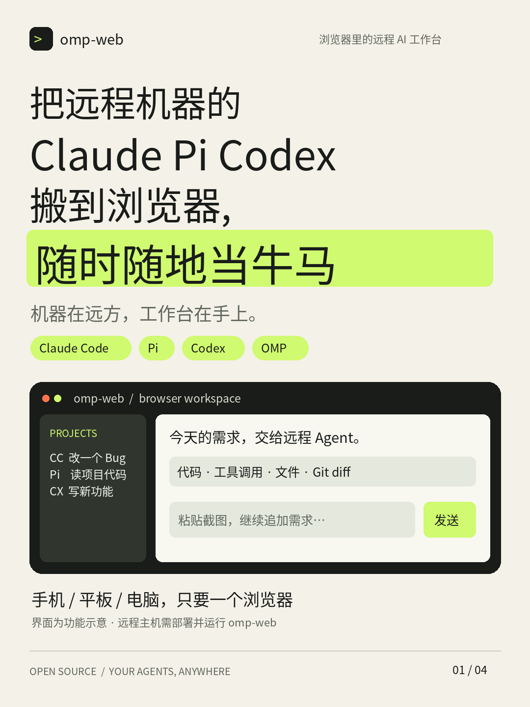
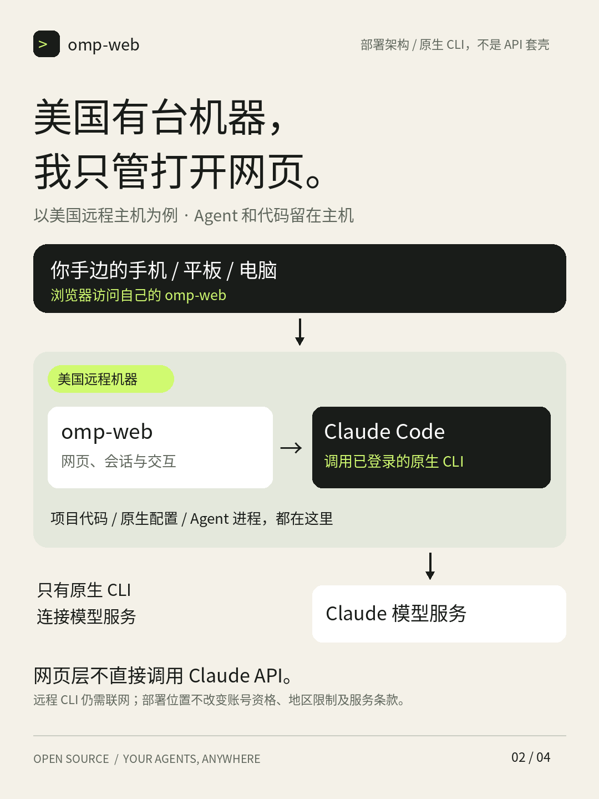
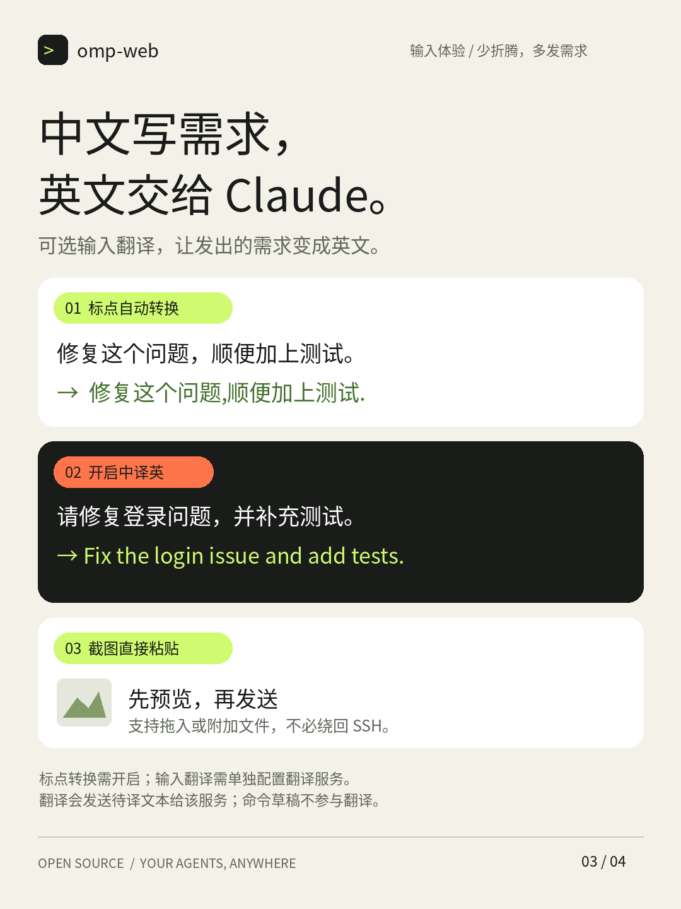
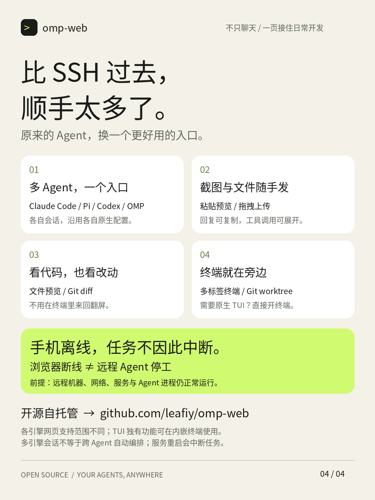

# omp-web · 一个网页搞定编程 Agent、终端和项目文件

[English](./README.md) · [简体中文](./README.zh-CN.md) · [项目主页](https://leafiy.github.io/omp-web/?lang=zh)

| 浏览器工作台 | 远程架构 |
| --- | --- |
| [](./public/promo/xiaohongshu/01-cover.png) | [](./public/promo/xiaohongshu/02-architecture.png) |
| **中文输入优化** | **日常开发工作流** |
| [](./public/promo/xiaohongshu/03-input.png) | [](./public/promo/xiaohongshu/04-workflow.png) |

在我的 PC 上，omp-web 已经取代了单独的终端窗口。**主机部署一次，浏览器零配置：打开网址，登录，选项目就能开工。** OMP、Pi、Claude Code、Codex 继续用主机上原来的账号和模型。


## 核心功能

### 1. 文件：拖进来，直接改，保存看效果

- **拖拽上传**：拖到文件夹，文件就传到那里；拖进聊天框，则作为附件发给 Agent。截图可以直接粘贴。
- **临时编辑**：改个错字不用再发一轮提示词，也不用开远程 IDE。Markdown、TXT、HTML/CSS、JS/TS、Python、Shell、SQL、JSON、YAML 等文本文件都能在网页里改。
- **预览和审查**：看 Markdown 排版、HTML 页面、图片、PDF、DOCX，播放音视频。点开 Git diff 看改动，选中源码几行就能引用到提问里。
- **文件管理**：新建、复制、移动、重命名、删除、下载。Agent 生成的报告可以从回复里直接打开或下载。

<details>
<summary>可编辑的文件格式（UTF-8，单文件不超过 256 KiB）</summary>

- 文档：`.md`、`.markdown`、`.mdx`、`.txt`
- 前端：`.htm`、`.html`、`.css`、`.scss`、`.js`、`.jsx`、`.mjs`、`.cjs`、`.ts`、`.tsx`
- 脚本与查询：`.py`、`.sh`、`.sql`
- 数据与配置：`.json`、`.jsonl`、`.csv`、`.xml`、`.yaml`、`.yml`、`.toml`、`.ini`、`.conf`

</details>

### 2. Agent 和终端：让它改，你来验

- **四个引擎任选**：按项目选模型、查技能、用 `/` 找命令。新任务可以开在独立的 Git worktree。
- **边跑边沟通**：用 Steer 纠正当前方向，用 Follow-up 排下一条需求；排队的消息还能取回修改。
- **少整理输入**：长日志自动折叠，草稿随会话保存。中文标点可自动转半角；开启翻译后，可中英互译提问和回复。
- **独立终端**：开多个 Shell 标签，自己跑测试、查日志、用原生 TUI。刷新可重连，终端输出不会自动发给 Agent。
- **审批和回退**：在网页上批计划、看 MCP 状态、处理权限请求；改错时可 Fork 或回退。各引擎支持范围见下表。

<details>
<summary>四个引擎功能对照</summary>

| 网页操作 | OMP | Pi | Claude Code | Codex CLI |
| --- | --- | --- | --- | --- |
| 聊天、图片、停止、恢复网页会话、选模型 | ✓ | ✓ | ✓ | ✓ |
| 网页 Follow-up 待发送队列／取回编辑 | ✓ | ✓ | ✓ | ✓ |
| 当前运行中 Steer | ✓ | ✓ | 原生版本支持时 | — |
| 思考强度／Effort | 按模型能力 | 按模型能力 | 按原生能力 | — |
| Fork／HTML 导出与完整历史 | ✓ | ✓ | ✓ | — |
| 回到之前的消息 | 会话内分支导航 | — | 回退对话和／或代码 | — |
| 权限模式／始终允许 | — | — | ✓ | — |
| MCP 状态面板／信息请求 | — | — | ✓ | — |
| 单独停止后台任务 | ✓（子代理） | — | ✓（并可转到后台） | — |
| 删除会话 | ✓ | ✓ | ✓ | — |
| 共享待办清单 | ✓ | ✓ | ✓ | ✓ |

</details>

### 3. 会话与 Todo：把下一步留在原处

- **会话、消息一键加入 Todo**：整个项目讨论值得跟进，就加整段会话；只想复查一条结论，就加那条回复。点待办直接跳回原处，所有登录设备共用。agent 也能读：消息里提到待办（如“完成待办第二项”）会自动附上带编号的列表，服务端另在 `~/.config/omp-web/todos.md` 保留一份。
- **多项目一起跟**：搜索、置顶、已读同步；哪个会话等你审批、哪个后台任务还在跑，一眼能看到。长历史按轮展开。
- **离开桌面也能接着做**：关浏览器不等于停任务。用手机或平板登录同一页，看结果、回审批、勾待办。额度、上下文和 Token 用量也能在网页里看。

## 安装与使用

**主机需要** Linux（systemd）或 macOS、Node.js 22.19.0 或更新版本（包括 Node 26）、npm、Git，以及至少一个已安装并登录的 Agent。文件管理器的修改操作目前限 Linux。

```bash
curl -fsSL https://raw.githubusercontent.com/leafiy/omp-web/main/scripts/install.sh | bash
```

1. 安装器会启动后台服务，首次安装时输出 `admin` 的初始密码。在主机打开 [127.0.0.1:30141](http://127.0.0.1:30141) 登录；已有账号不会被替换。
2. 选项目和引擎，拖入样本或粘贴截图，发出第一条需求。
3. 看 diff，在内嵌终端跑测试；把需要复查的回复加入 Todo。

默认仅允许本机访问。远程访问请用 HTTPS 或私有网络，可用 `--service --host <地址>` 显式指定监听地址。**不要把终端明文暴露到公网**。更新请在网页外运行 `bash ~/code/omp-web/scripts/install.sh update`；重建会中断聊天和终端。`bash ~/code/omp-web/scripts/install.sh restart` 只按现有构建重启已安装的服务，不更新。

[手动安装与终端](./docs/self-hosting.zh-CN.md) · [部署与更新](./docs/workspace.zh-CN.md) · [文件与附件](./docs/file-browser.zh-CN.md) · [Claude 高级控制](./docs/claude-code-advanced.zh-CN.md) · [全部文档](./docs/)

基于 [17380936778/omp-web](https://github.com/17380936778/omp-web) 和 [agegr/pi-web](https://github.com/agegr/pi-web)。[与上游的改动对比](https://github.com/leafiy/omp-web/compare/f09920e04ed4851ad10d86c6fc92d95c2b3485c1...66636ff) · [MIT 许可证](./LICENSE)
