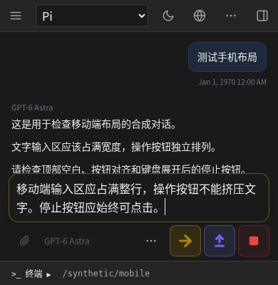

# 移动端工具栏与输入区修复

## 修复

- 浏览器模式不重复加入顶部安全区；独立应用／全屏模式通过 CSS 条件保留真实安全区。
- 窄工具栏固定为一行 44px 控件（外加底边线），主题和语言使用图标；历史、系统提示、上下文信息与 OMP 分支保留在“更多操作”中。
- 输入文字占满输入框宽度；发送、Steer、Follow-up、Stop 独立位于下方操作栏。手机按钮为 44×44，停止不再藏在“更多控件”里。
- 菜单限制在可视区域内，关闭菜单不误触停止。键盘收起但焦点已经移走时继续使用可视高度，直到键盘真正收完。
- 常规宽屏保留文字按钮；窄聊天列使用紧凑顶栏。没有修改 Agent 协议、账户或权限。

## 复现与验证

旧版本在 390px 下顶栏高 73px，模拟 44px 安全区时高 117px；运行中文字区仅约 155/358px，停止按钮位于隐藏菜单。另一个用例复现焦点移走后的键盘过渡：可视高度 420px，停止按钮却位于 y=760–804px。

`node scripts/check-mobile-layout.mjs http://127.0.0.1:<隔离预览端口>` 使用真实编译 UI 和合成 API，检查 320/360/390/430px、横屏、两种键盘尺寸变化、焦点移开过渡、中英文、明暗主题、安全区、菜单边界和触摸点击。没有真实模型请求。

14 个浏览器布局场景、17 项相关单元测试、类型检查、隔离构建及原有聊天／follow-up 浏览器回归通过。全量 474 项中 458 项通过，16 项失败与之前相同，无新增失败。CDP 无法切换真实安装 PWA 的 display-mode：条件样式通过源码及已加载 CSS 检查，安全区几何使用显式 inset fixture；不宣称已在真机 PWA 验收。

## 发布范围

用户仅授权本轮更新 GitHub 和 `192.168.52.3`，本机生产服务不重启。候选 Build ID：`7L4mkK924_iLsBxIVlokt`。本机验证目录 `/opt/omp-web-mobile-stage-pnK03nEn`；远端发布目录 `/opt/omp-web-releases/20261107-mobile-pnK03nEn`。

发布前远端有两个运行中的 Agent，必须等空闲后切换，不强制中断。远端 `status.json` 的 `phase: active` 才代表部署成功；等待状态见 `waiting-status.json`，超时不会强杀任务。保留上一发布用于回滚。
